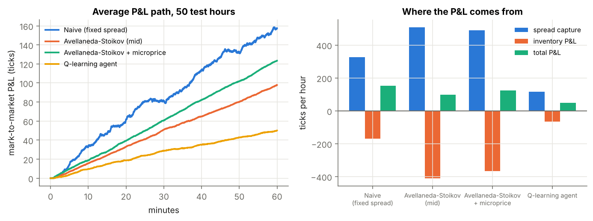
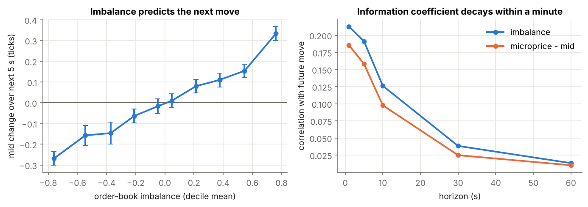
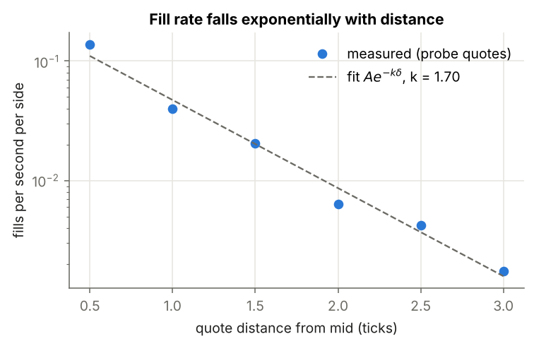
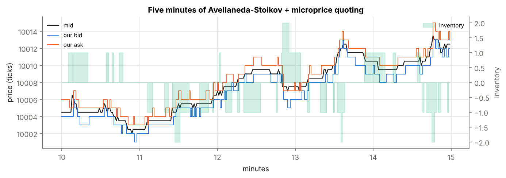
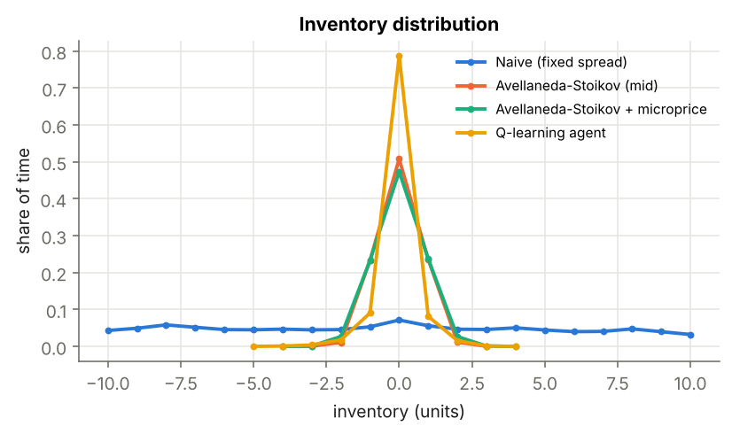
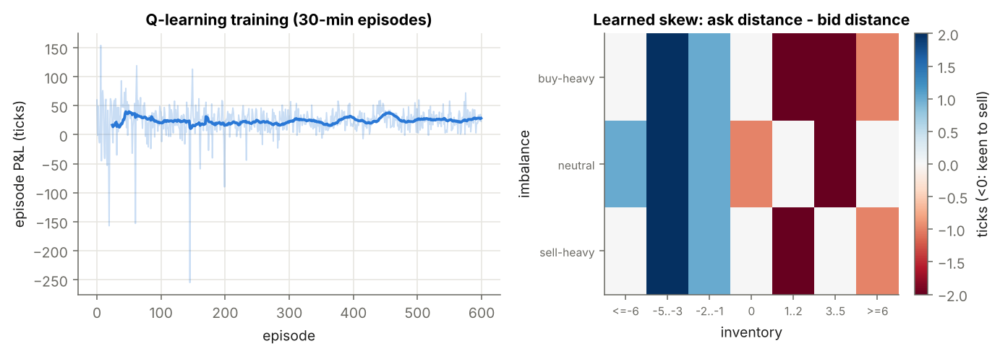
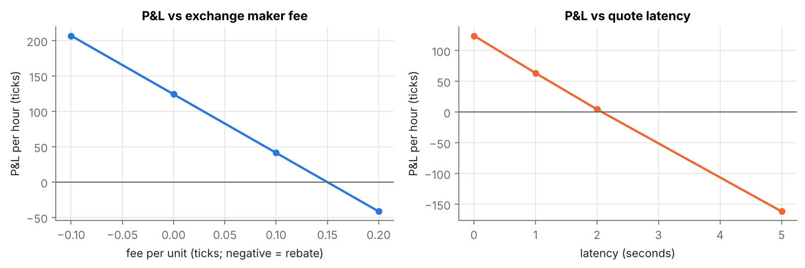

# Market Making on a Limit Order Book

A limit order book simulator and four market-making strategies, from a naive fixed spread to Avellaneda-Stoikov and a reinforcement-learning agent. It also includes a replay backtester for real exchange data, a live data recorder for Binance, and a C++ matching engine.

**Highlights** (50 one-hour out-of-sample episodes)
- **Risk-adjusted performance:** Avellaneda-Stoikov (Guéant-Lehalle-Fernandez-Tapia closed form) earns **5× the Sharpe ratio** of a naive quoter (5.6 vs 1.1), holding **10× less inventory**.
- **Order-book signal:** centring quotes on the **microprice** adds **26% more P&L** (97 → 123 ticks per hour) and cuts adverse selection by 14%. Imbalance predicts the next 5 s move with an information coefficient of 0.19.
- **Reinforcement learning:** a **Q-learning agent** discovers inventory skewing by itself. It is profitable out of sample (Sharpe 2.6) but more cautious than the closed-form model.
- **Speed and fees decide everything:** **2 seconds of latency or a 0.15-tick fee** erases the edge.
- **C++ matching engine:** price-time priority, **5.8 million messages per second**.

## What's inside

| Module | What it does |
|---|---|
| `mmlab/orderbook.py` | Price-time priority order book: limit, market, cancel, partial fills, queue position |
| `mmlab/market.py` | Simulated market: hidden fair value, slow liquidity providers, noise traders and **informed traders** who create adverse selection; our quotes keep their queue priority; latency and fees |
| `mmlab/signals.py` | Order-book imbalance and microprice, their information coefficient by horizon |
| `mmlab/calibration.py` | Volatility and fill intensity λ(δ) = A e^(−kδ) measured with probe quotes |
| `mmlab/strategies.py` | Naive fixed spread · Avellaneda-Stoikov (GLFT closed form) · the same on the microprice · tabular Q-learning agent |
| `mmlab/backtest.py` | Episode runner, exact P&L attribution (spread capture, inventory P&L, fees, liquidation), 10 s markouts |
| `mmlab/replay.py` | Backtest on recorded data with a conservative queue model; calibration from data |
| `scripts/record_binance.py` | Records live Binance order book (top 5 levels) and trades to CSV |
| `cpp/` | Header-only C++17 matching engine, tests and throughput benchmark |

## The market model
Every step is one second.
- **Fair value:** a hidden value V follows a random walk.
- **Liquidity providers:** they post limit orders around a blend of the mid and V (they are slow) and cancel at random.
- **Noise traders:** they send market orders in random directions.
- **Informed traders:** they send market orders toward V whenever the mid is wrong by more than half a tick.

The informed traders are what make market making hard. They pick off stale quotes, which is **adverse selection**, and they eat one side of the book first, which makes **imbalance** informative. The resulting market has a typical spread of 1–3 ticks, about 7 units at the best price, and order flow that is mean-reverting at the 1-second scale.

## Results
All numbers are reproduced by `python examples/run_experiments.py` (about 2 minutes). Calibration and parameter choices use training seeds only. The comparison uses test seeds 1000–1049, which were never used for any choice. P&L is in ticks per hour, trading one unit per quote, after liquidating the final inventory at the half-spread.

| Strategy | Mean P&L | Std | Sharpe (per hour) | Fills | Spread capture | Inventory P&L | 10 s markout | Mean \|inventory\| |
|---|---:|---:|---:|---:|---:|---:|---:|---:|
| Naive (fixed spread) | 153.4 | 139.5 | 1.10 | 297 | 326.8 | −169.4 | −154.2 | 4.97 |
| Avellaneda-Stoikov (mid) | 97.4 | 17.5 | 5.57 | 897 | 507.9 | −410.1 | −403.9 | 0.52 |
| Avellaneda-Stoikov + microprice | **123.0** | 21.4 | **5.76** | 823 | 488.8 | −365.4 | −348.3 | 0.59 |
| Q-learning agent | 49.9 | 18.9 | 2.63 | 100 | 115.7 | −65.6 | −63.4 | 0.26 |

**How to read it**
- **The naive quoter earns the most on average, but with 8× the volatility.** It sits on up to ±10 units of inventory and lets the price move it around. Per unit of risk, Avellaneda-Stoikov is 5× better. That is the number a risk manager cares about.
- **Avellaneda-Stoikov quotes tighter and trades 3× more.** It earns more spread but suffers more adverse selection (markout −404), and its inventory skew keeps risk tiny.
- **The microprice anticipates the next move.** Quotes are moved away from the side about to be eaten, so adverse selection drops from −404 to −348 and P&L rises 26%.
- **The Q-learning agent learned to skew on its own.** It quotes its ask closer when long and its bid closer when short (figure below), but it chose wide spreads at flat inventory and so trades far less.



### Order-book signals
Imbalance I = (Q_bid − Q_ask)/(Q_bid + Q_ask) at the best prices. Its correlation with the next move is 0.21 at 1 s, 0.19 at 5 s, 0.13 at 10 s, and almost zero after a minute: a classic short-lived microstructure signal.



### Calibration
The fill intensity is measured by quoting a probe at fixed distances from the mid and counting fills. The log-linear fit gives k = 1.70 per tick, the input to the Avellaneda-Stoikov formulas.



### What the strategy does
Five minutes of the Avellaneda-Stoikov + microprice quoter. Its quotes follow the mid, and they shift down when it is long and up when it is short, pulling inventory back to zero.





### Reinforcement learning
- **State:** an inventory bucket and an imbalance bucket.
- **Actions:** bid and ask distances of 1–3 ticks from the microprice.
- **Reward:** the change in P&L minus 0.02·q² (the same inventory-risk term as Avellaneda-Stoikov).
- **Training:** 600 half-hour episodes on training seeds.

The heatmap shows the skew the agent learned: blue means keen to buy, red keen to sell.



### Fees and latency
With latency, quotes go live L seconds after the book was observed, so they are stale exactly when informed traders arrive. The edge disappears at about **2 s of latency** or a **0.15-tick maker fee per unit**. This is why market makers invest in speed and negotiate fee tiers.



### C++ matching engine
```
5,000,000 messages in 0.86 s -> 5.81 M messages/s   (random flow: 45% limits, 42% cancels, 13% market orders)
```
Measured on a 2-core cloud VM, `-O3`. The engine uses `std::map` price levels with FIFO lists and an `unordered_map` id index, giving O(1) cancels.

## Running on real market data
```bash
pip install websockets
python scripts/record_binance.py BTCUSDT 3600          # one hour of live Binance data (public, no account)
```
```python
from mmlab.replay import load, calibrate, run_replay
from mmlab.strategies import GLFT
d = load("data/BTCUSDT_snapshots.csv", "data/BTCUSDT_trades.csv", tick_size=0.01)
sigma, A, k = calibrate(d)
print(run_replay(GLFT(A=A, k=k, sigma=sigma, gamma=0.5, use_microprice=True), d, order_size=0.001).pnl)
```
The replay uses a conservative queue model. Our order joins the back of the displayed queue, is filled by trades through its price, and at its own price only after the quantity ahead of it has traded. Replays ignore our own market impact, so treat replay P&L as an upper bound.

`data/sample_*.csv` is **simulator output** written in the recorder's format, so the replay path can be tested offline. It is not real market data.

## Quick start
```bash
pip install -e ".[dev]"
pytest -q                               # 13 tests
python examples/run_experiments.py      # all results and figures

cmake -S cpp -B cpp/build -DCMAKE_BUILD_TYPE=Release && cmake --build cpp/build -j
./cpp/build/test_order_book && ./cpp/build/benchmark
```

## Theory notes
- **Avellaneda-Stoikov (2008).** A market maker with exponential utility quotes around a reservation price that shifts against inventory. The spread pays for fills and risk.
- **Guéant-Lehalle-Fernandez-Tapia (2013).** Closed-form asymptotic quotes with no dependence on the end of the trading day. With fill intensity A e^(−kδ), risk aversion γ and volatility σ:
  - δ_bid = c₁ + (2q+1)/2 · c₂ and δ_ask = c₁ − (2q−1)/2 · c₂
  - c₁ = ln(1 + γ/k)/γ and c₂ = √(σ²γ/(2kA) · (1 + γ/k)^(1+k/γ))
- **Microprice (Stoikov, 2018).** A better short-term estimate of value than the mid, using queue sizes.
- **Glosten-Milgrom (1985).** Spreads exist to pay market makers for trading against better-informed traders. The markout column measures exactly that cost.

## Limitations and next steps
- **The market is simulated.** Real data enters only through the replay path. Next: record a week of BTC-USDT and compare.
- **The RL agent is tabular with a small action set.** Next: a policy-gradient agent with continuous quotes and richer state (volatility, recent fills).
- **One asset, one unit per quote.** Next: size decisions, multi-asset hedging, and a Hawkes-process order flow for clustering.

## License
MIT
